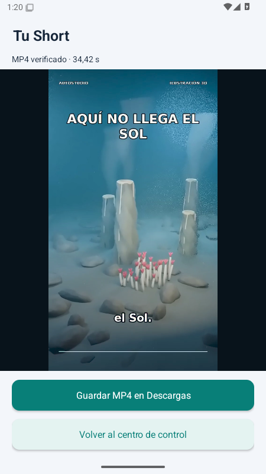

# Android LAB 0.3 — fallos corregidos y entrega verificada

Fecha: 17 de noviembre de 2026. Se conservó el proyecto, los perfiles classic/cinematic, el catálogo, los renders y las versiones estables anteriores. No se ha publicado en YouTube ni utilizado una API de IA de pago.

## Causas exactas consultadas en los registros

| Ejecución | Resultado y evidencia | Corrección |
| --- | --- | --- |
| 44085521884, 44086726077 y 44086768350 | Los tres registros de arranque muestran `line 5: adb: command not found`, salida 127. El SDK estaba instalado pero platform-tools no estaba en PATH. El emulador también buscaba un AVD `AutoStudio.ini` que no encontraba en su carpeta predeterminada. | Ejecutables SDK por ruta absoluta; exportación de platform-tools para los pasos instrumentales; una carpeta explícita y común de usuario/AVD/emulador; validación del dispositivo real creado antes de iniciar. |
| 44088054411 | El arranque ya funciona y ambos APK se instalan; no llega a confirmar la conexión guardada. | Diagnóstico instrumental más preciso, conservando los fallos como fallos. |
| 44089112897 | `native_github_api_verified: true`, pero la pantalla indica `La credencial no tiene un formato válido`. La API aceptaba la credencial; el filtro local solo admitía un alfabeto antiguo y un máximo de 512 caracteres. | Tratar la credencial como opaca, admitir hasta 8192 caracteres ASCII visibles y seguir rechazando espacios, controles y CR/LF. La comprobación real con GitHub y el cifrado AES-GCM/Keystore se mantienen. |
| 44089941997 | `UnknownHostException: Unable to resolve host "api.github.com"` en el arranque de otro emulador. | DNS explícito en el emulador de CI y reintentos acotados del sondeo inicial solo para errores transitorios de red. No se ignoran errores de autorización ni se cambia el DNS del teléfono. |
| 44090864966 | **SUCCESS**: compilación, instalación, conexión, producción real, recuperación, reproducción y reinicio de proceso. | Resultado utilizado para la entrega. |

Los registros exactos de las tres ejecuciones iniciales se recuperaron mediante la API de Actions desde un runner autorizado y se conservan, saneados, en [diagnostics de la rama de resultados](https://github.com/Luixifer/AutoStudio/tree/android-preview/diagnostics). La API no era accesible desde este entorno de desarrollo; no se inventaron sus registros ni se dedujo el código 127 únicamente por su número.

## Prueba integral real

- [Android LAB 44090864966](https://github.com/Luixifer/AutoStudio/actions/runs/44090864966): éxito, 5 min 29 s; código `a6fac97b13244f859193e2321a8e8a08b5b59b59`, checkout limpio.
- Android 15/API 35 x86_64, 450×800, KVM y renderizado software de emulador. Es una prueba real de Android emulado, **no una prueba física del S25 Ultra**.
- La interfaz recibe una credencial temporal de Actions en ejecución, verifica GitHub y la guarda cifrada; se comprueba que no figura en texto claro en preferencias.
- Introduce el tema, pulsa Generar Short y persiste `010292edba5d4c5ea9794fe7832c7ddb`. Se recrea la actividad y se conserva esa solicitud.
- La propia APK inicia [producción 44091290548](https://github.com/Luixifer/AutoStudio/actions/runs/44091290548), terminada correctamente en 2 min 32 s. No se despachó el trabajo desde un sustituto del cliente Android.
- Recupera el resultado de ese UUID/run ID, descarga el MP4 y comprueba tamaño/SHA. Reproduce mediante VideoView/MediaPlayer: fotograma realmente renderizado y posición avanzando a 1167 ms.
- Tras `am force-stop`, una nueva ejecución conserva el mismo UUID y MP4, historial de una producción, conexión cifrada y reproducción nativa (1077 ms). No se solicita otra producción.
- 57 pruebas Python superadas, incluidas las regresiones anteriores y del arranque; 12 comprobaciones JVM ejecutables sobre formatos de credenciales, longitudes y rechazo de controles/inyección de cabeceras.

No se afirma haber visto el vídeo completo en Android ni escuchado físicamente su audio: el sondeo instrumental verifica inicio de reproducción, fotograma y avance. El emulador usa `-no-audio`. La decodificación completa del MP4 y sus controles de señal sonora sí se verificaron en el runner y después de descargarlo.

## APK descargada y verificada

[APK exacta de esta prueba](https://github.com/Luixifer/AutoStudio/raw/d0e5bfbede04afecc9abd561137bbe0d1d547087/AutoStudio-Control-0.3.0-lab.apk) · [ZIP alternativo](https://github.com/Luixifer/AutoStudio/raw/d0e5bfbede04afecc9abd561137bbe0d1d547087/AutoStudio-Control-0.3.0-lab.zip)

- Aplicación: `com.luixifer.autostudio.lab`, versión `0.3.0-lab`; 66.018 bytes. Java DEX sin bibliotecas nativas, no incluye modelos de voz, renderizador ni credenciales.
- SHA-256: `8d6d4c214471a109fef11ad7e81e1590052700d44cfde1d0058f52da61a341e7`.
- `apksigner verify` sobre el archivo descargado: firmas **v2 y v3 válidas**, certificado de depuración `CN=Android Debug, O=AutoStudio Lab, C=ES`.
- Huella SHA-256 del certificado: `474a8ab7cbd44d887fed6ff28ae04994dc9cb6e4407b8c611ea4a97160ac92d7`.
- ZIP íntegro, contiene el mismo APK byte a byte; archivo sin claves `.jks`/`.keystore`. Se comprueba que el DEX contiene la corrección de formato.
- Descarga pública del APK probada: HTTP 200, `application/octet-stream`, longitud coincidente. Enlace fijado al commit de resultados `d0e5bfbede04afecc9abd561137bbe0d1d547087`.

El MP4 recuperado también se descargó y verificó fuera de Actions: 34,40 s, 5.278.833 bytes, H.264 720×1280/25 fps, AAC estéreo 48 kHz, fast-start y decodificación completa. Su SHA coincide con el archivo reproducido por Android: `c64d4af5f1fe151bfe6682d30c7d55cd6b84564bf5f1fefdc75aa2a35416c2ac`.

Los resultados estructurados están en [evidence/verified-run.json](evidence/verified-run.json).

## Autorización y límites pendientes

Para tu instalación necesitas tu propia autorización de GitHub: token de granularidad fina, **solo AutoStudio**, **Actions: lectura/escritura** y **Contents: lectura**. Sigue [la guía móvil](README.md). El token de Codex Connector no se copia a la aplicación, y la credencial temporal del test no se distribuye en el APK. No se ha probado tu token personal porque no lo has proporcionado ni debes enviarlo por chat.

Quedan pendientes la prueba física del S25 Ultra, la escucha de audio, Guardar en Descargas en el dispositivo y las interrupciones propias de Samsung. El build es de laboratorio y depurable, no una publicación comercial; las claves de depuración de futuras compilaciones pueden diferir (ver guía antes de reemplazar una instalación con datos).

Este incremento genera Shorts del contenido gratuito realmente disponible del océano. Temas científicos arbitrarios, documentales, cola de producción y regeneración aislada de escenas siguen pendientes; no se presentan como implementados. YouTube y ChatGPT permanecen desactivados. Las herramientas y el runner estándar de repositorio público siguen siendo la configuración gratuita; no se contratan servidores ni se cambia la facturación.
