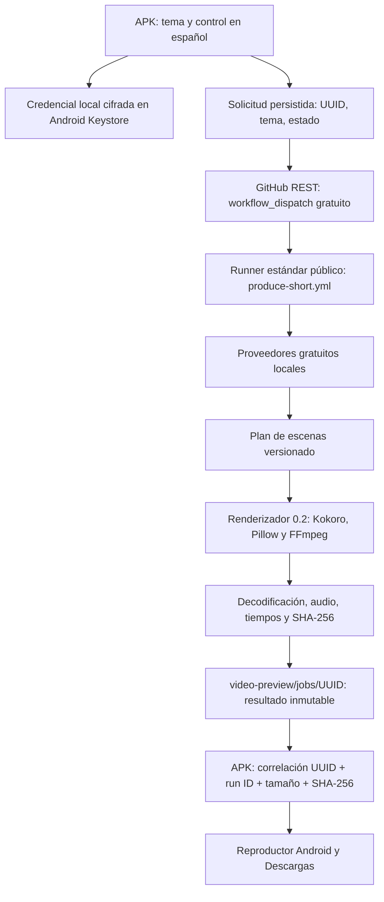

# Control Android — incremento 0.3

No hay servidor contratado. El APK orquesta trabajos de GitHub, no renderiza. No hay credenciales dentro del APK ni una integración de inferencia de pago. La credencial temporal utilizada en CI se inyecta al test en ejecución y nunca se compila, publica ni incorpora al archivo.

## Contratos y aislamiento

`content/catalog.json` delimita contenido realmente disponible. `scripts/providers/` separa guiones y recursos de montaje. El proveedor local devuelve el guion redactado del océano: no se atribuye autoría generativa a un selector de temas. Fuera del catálogo se informa de falta de contenido.

`production.py` valida tema/UUID/proveedor/formato, construye `story.json` y `scene-plan.json`, llama al renderizador existente y añade las duraciones reales. El renderizador conserva los contratos previos; solo incorpora metadatos de producción cuando existen. `publish_job.py` usa sus verificaciones de contexto/commit/SHA y publica solo la solicitud correlacionada. Rechaza sobrescribir un UUID publicado.

El cliente distingue envío incierto, espera, ejecución, descarga, listo y fallo. Guarda antes del envío; no reintenta POST automáticamente. Reanudar una pantalla consulta el UUID/run ID ya persistido. Una caída de red no debe producir un segundo vídeo. La consulta se pausa cuando la pantalla de control no está visible; Actions sigue ejecutándose.

## Seguridad y límites

- API autenticada: exclusivamente `https://api.github.com/repos/Luixifer/AutoStudio/...`; sin redirecciones de autorización.
- Descargas públicas: exclusivamente `raw.githubusercontent.com` y rutas del UUID validado, sin enviar credencial. JSON limitado a 512 KiB, MP4 a 20 MiB, confirmación de tamaño y SHA antes de reproducir.
- Sin acceso general a almacenamiento, cámara, micrófono o ubicación. Copia mediante MediaStore/selector del sistema.
- Token cifrado AES-GCM/Keystore, pantalla de conexión protegida contra capturas, copias y transferencia excluidas. APK de laboratorio depurable: no es un build final de distribución.
- Resultados públicos; no se deben introducir secretos ni contenido privado como temas.
- Solo repositorio público y runner estándar gratuito. Una producción concurrente, límites anteriores de 150 segundos/20 MiB. No Artifacts, cron, GPU ni servicios de IA facturados.
- La rama de resultados crece con los vídeos: es almacenamiento de evaluación, no una plataforma ilimitada para miles de documentales. No se borran archivos anteriores para disimularlo.

## Secuencia posterior al recorrido prioritario

1. Validación física de la APK y del acceso GitHub en S25 Ultra.
2. Cola de cliente persistente que despache secuencialmente: la concurrencia de Actions no es por sí sola una cola durable ilimitada.
3. Caché por escena con clave de narración, voz/modelo, recurso, efectos, versión y contexto de transición. Regenerar una escena requiere volver a ensamblar el MP4 y puede invalidar la transición de la siguiente; no se promete copiar bytes a ciegas.
4. Editor y pruebas de reutilización real, con contadores de escenas renderizadas y hashes conservados. Actualmente no implementado ni validado.
5. Más contenido/proveedores gratuitos y documentales dentro de límites de runner; investigación y licencias verificadas. ChatGPT y YouTube permanecen desactivados.

La aplicación no se describe como «centro de control completo»: esta entrega prioriza un recorrido real verificable.
