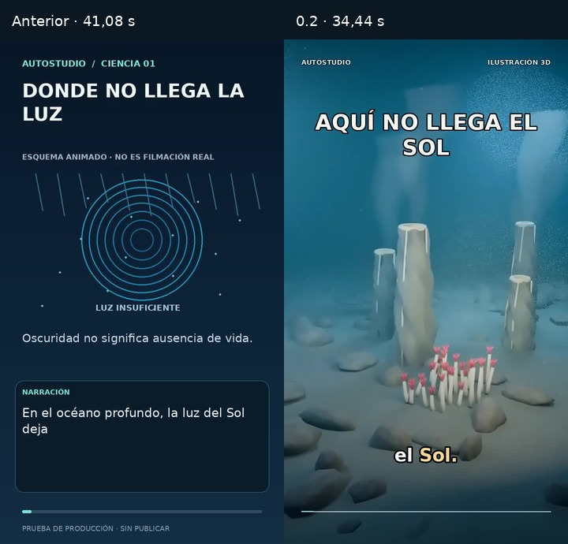
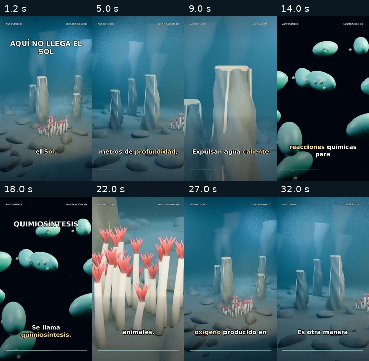

# AutoStudio 0.2 — revisión audiovisual

## Base conservada

La versión de 41,08 segundos sigue accesible por su commit fijo de resultados `81eb7dfb0874b4483c86b45b1894f1a7bf1ff95b` y por la etiqueta de código `baseline-mvp-41s`. El perfil `classic` mantiene sus tres diagramas, voz eSpeak y estimaciones temporales. El nuevo perfil no elimina esa opción.

## Diferencias comprobables en el producto

Ocho escenas editadas frente a tres; cinco imágenes 3D originales frente a esquemas planos; movimiento de encuadre, partículas y mezcla entre planos. No hay caja con narración completa. El texto aparece en grupos de hasta tres palabras y cambia de color según la duración de fonemas emitida por el modelo neural. Narración `ef_dora` sintetizada en CPU, no servicio online. Ambiente sintético a nivel bajo, voz normalizada y limitador.

La cobertura de cada palabra y el movimiento de cada plano se verifican durante el render. La generación completa y sus verificaciones se han ejecutado tanto en desarrollo como en GitHub Actions. La comprobación pública y los resultados descargados se detallan a continuación.

## Revisión visual y límites honestos

- Las ilustraciones añaden relieve, perspectiva, iluminación, materiales y cambios de escala, pero tienen acabado estilizado y simplificado. No alcanzan todavía un documental cinematográfico competitivo ni son fotorrealistas.
- El filtro reduce ruido de los renders CPU a costa de suavizar detalles. Las partículas y movimientos de cámara no equivalen a animación 3D submarina completa: los animales y la salida de minerales están en imágenes fijas. El maestro y el generador permiten mejorarlos sin rehacer el montaje.
- La iluminación representa focos virtuales de exploración; el fondo marino no recibe luz solar. Las células son una ilustración explicativa, no fotomicrografía.
- La voz ahora utiliza un modelo neuronal, pero la naturalidad de España, acentos concretos y dicción científica necesitan escucha humana. No se afirma una evaluación física del audio en Samsung.
- Los tiempos provienen del modelo que genera el audio: mejor fundamento que proporciones por caracteres, pero pueden existir errores fonéticos. No se ha realizado una alineación independiente con ASR ni valoración auditiva humana de sincronía.
- La ausencia de clipping o silencio no prueba que la narración sea buena. El guion necesita comprobación científica antes de publicar; la precisión visual de especies y geometrías es ilustrativa.
- Las pruebas técnicas y las mediciones de cambio de píxeles no conceden aprobación estética automática.

## Siguiente salto de calidad

Primero evaluar el MP4 en móvil: voz, velocidad de lectura y comprensión. Después: rehacer el arte con mayor realismo, añadir animación real de fluidos o imágenes científicas con permisos comprobados y diseñar una banda sonora original más narrativa. No contratar ni activar servicios de pago para conseguirlo.

## Ejecución real verificada — 17 de noviembre de 2026

- [GitHub Actions 44074329488](https://github.com/Luixifer/AutoStudio/actions/runs/44074329488): **SUCCESS**, duración de trabajo 1 min 59 s.
- Código ejecutado: `5c5c60e22417a32f09f138452bf3c8f02361f77a`, checkout limpio.
- Resultados: [`efed2972fdad05c364512744fdf45ef1e1776ec3`](https://github.com/Luixifer/AutoStudio/tree/efed2972fdad05c364512744fdf45ef1e1776ec3).
- **34 pruebas superadas**, incluidas las 16 anteriores; también pasan en el entorno de desarrollo.
- [MP4 de esta ejecución, enlace fijo](https://github.com/Luixifer/AutoStudio/raw/efed2972fdad05c364512744fdf45ef1e1776ec3/short_ciencia_demo.mp4): **34.44 s**, 720×1280, 25 fps, H.264/AAC estéreo a 48 kHz; 5,292,420 bytes.
- SHA-256: `32d0735bc4a034d12c2f308cd50659d3b51ad09353e87ff9e98e3eb657fea8cd`.
- Descarga real y segunda decodificación completa realizadas fuera de Actions. Hash coincidente con `validation.json`; los hashes de todos los scripts también coinciden con la ejecución.
- Audio decodificado: RMS -18.1 dBFS, pico -1.45 dBFS, sin muestras a escala completa. Estos datos no miden naturalidad.
- 8 planos, 29 bloques de subtítulos, 77 palabras con tiempos del modelo; máximo tres palabras y dos líneas. Planos de 1.96 a 6.96 segundos.
- Tiempo de generación registrado en el runner: 73.99 s (no incluye toda la instalación).
- **No se ha publicado en YouTube ni utilizado una API de inferencia de pago.** No se ha comprobado la reproducción o escucha física en Samsung.

## Inspección del MP4 real

Se han extraído y revisado ocho fotogramas del archivo descargado de Actions. Los cambios respecto a la versión anterior son visibles: desaparece el panel de párrafos, la imagen ocupa el encuadre y se alternan planos generales, chimeneas, comunidad animal e ilustración celular. Los subtítulos son breves y legibles en las imágenes inspeccionadas; su valoración de sincronía auditiva queda pendiente.

La inspección también confirma los límites: formas de chimeneas y organismos demasiado simplificadas para un documental de gran calidad, ruido residual en las plumas y falta de movimiento orgánico en animales y fluidos. No se declara alcanzada una calidad cinematográfica competitiva. Esta revisión es una mejora de montaje y una nueva base audiovisual verificable, pendiente de tu aprobación perceptiva.

La comparación usa ambos vídeos reales a 1,2 s y el mismo tamaño reducido para revisión; no pretende igualar dos narraciones diferentes. `images/02-provenance.json` registra las fuentes, tiempos y hash. No son imágenes conceptuales presentadas como vídeo.

## Evaluarlo en el S25 Ultra

1. Descarga el MP4 con el enlace fijo y ábrelo con sonido, preferiblemente también con auriculares.
2. Escucha especialmente «quimiosíntesis», «compuestos químicos» y «oxígeno»: acento, dicción, pausas y velocidad.
3. Comprueba si el resaltado sigue las palabras que oyes y si permite mirar la imagen sin esfuerzo.
4. Valora el gancho inicial, la repetición de ilustraciones y la conclusión. Indica segundos concretos de los defectos.
5. No se necesita iniciar sesión en servicios externos ni aceptar pagos. Para repetirlo: Actions → Run workflow → cinematic.
