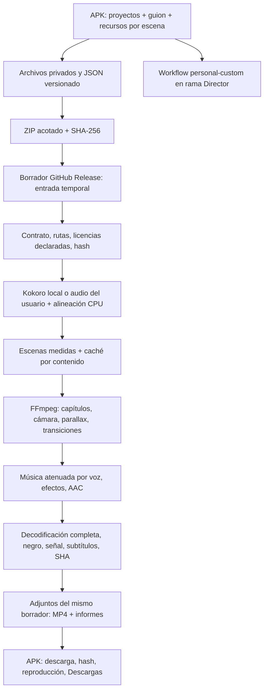

# AutoStudio Director — auditoría previa y arquitectura

Fecha: 20-11-2026. Rama independiente `codex/autostudio-director`.

## Qué se encontró realmente

La copia local estaba en `256089d`. Se consultó GitHub y se incorporó por avance rápido **a la rama nueva**, sin escribir main, la revisión remota `2a7f633`. Ignorar esas actualizaciones habría perdido los pilotos visuales, Whisper/Silero y los workflows personales existentes. Árbol inicial limpio; ningún archivo de usuario eliminado.

- Shorts 0.1–0.4: renderer, catálogo, arte original, pruebas, voces, subtítulos y resultados por UUID. Se conservan sus presupuestos y validadores; **no se amplían silenciosamente sus límites**.
- Android Java: Keystore, SAF/MediaStore disponibles mediante plataforma, conexión GitHub, recuperación de solicitudes, reproductor nativo. Se conserva el build anterior por defecto. Director es una variante separada `com.luixifer.autostudio.director.lab`.
- `personal-custom.yml` fija su editor a `e722cf94007e326fd6a4537ad57ebbc60b43faa9`. Sus módulos personales no estaban en el árbol de main, aunque sí en Git. Se recuperaron desde esa revisión, con SHA-256 por archivo en `reused-personal-engine.json`; se reutilizan cámara cosenoidal, ASS y agrupación de subtítulos. No se reconstruyeron desde cero.
- Kokoro CPU ya permite Álex, Santa y Dora. Dora sigue siendo el valor por defecto del motor antiguo. Director propone Álex; **no hay aprobación de naturalidad, profundidad, interpretación ni acento mediante escucha humana**.
- Whisper/Silero ya existen como QA opcional. Para audio importado, Director utiliza tiempos aportados o Whisper CPU y exige coincidencia textual; falla ante discrepancias en lugar de inventar sincronización.
- Hay proveedores experimentales Cloudflare/Gemma/FLUX con secretos y cuotas. **Director no los llama ni exige esos secretos**. Las imágenes y clips llegan del usuario.
- Motor personal anterior: imágenes, WAV, hasta 720p documental/30 minutos, 60 FPS, montaje por cortes. No admitía el contrato pedido de MP4, MP3, 1080p, parallax, música con ducking ni capítulos de 60 minutos.

## Arquitectura incremental

`scripts/director/project.py`: esquema `autostudio-director/1`, IDs estables, capítulos y escenas ordenados, recursos relativos, procedencia. No ejecuta instrucciones del JSON ni descarga URLs arbitrarias. ZIP: máximo 200 MiB descomprimidos, 3.000 entradas, sin traversal, enlaces simbólicos ni duplicados.

`engine.py`: narración real → duración por escena redondeada a fotogramas, sin solapar voces. Las transiciones utilizan **colas visuales adicionales**. Cada capítulo conserva PCM; el montaje final codifica AAC una vez y evita concatenar voces AAC con retardos repetidos. Fotogramas clave con interpolación cosenoidal, imágenes sin deformación y parallax con hasta tres capas alpha reales. Los clips se recortan y normalizan; repetirlos exige una decisión explícita.

La normalización recodifica vídeo: no se promete copia sin pérdida de clips de formatos distintos. `contain` conserva toda la imagen principal con márgenes; `cover` recorta expresamente sin deformar.

`scripts/director/cloud.py`: token temporal del runner, APIs oficiales, adjuntos fuera de Git. Nunca envía Authorization al host firmado de descarga. Resultados ligados al UUID, SHA y ejecución reales. YouTube desactivado.

## Riesgos y límites explícitos

1. Un borrador en un repositorio público **no se presenta como almacén confidencial**. La APK advierte antes de enviar. No publicar manualmente ese borrador si contiene material privado.
2. No hay un servicio de almacenamiento ilimitado. Se mantienen los adjuntos para recuperación; su limpieza tras revisión es manual en este incremento. Los originales permanecen en el teléfono.
3. Máximo 30 escenas y diez minutos por capítulo, 24 capítulos y 60 minutos por proyecto; son límites de seguridad, **no evidencia de haber producido 60 minutos**.
4. Caché por escena comprobada por hash en el mismo directorio de trabajo. No sobrevive automáticamente al borrado de un runner. `--chapter` permite producir una parte; el reparto entre varios runners y la reanudación distribuida requieren más trabajo.
5. El primer arranque de voz/alineación descarga pesos gratuitos. Los errores se muestran; no existe fallback a APIs facturables ni a tiempos calculados por palabras.
6. Subtítulos medidos no equivalen a revisión humana de dicción, ritmo o precisión científica. La comprobación de negro puede exigir revisión de una escena nocturna realmente negra; no se desactiva automáticamente.
7. La APK mantiene subida/descarga en primer plano. Un cierre durante el transporte puede dejar una solicitud indeterminada; consultar antes de reenviar. No se promete transferencia Android en segundo plano todavía.
8. No se ha recibido el guion ni el material de Hessdalen. El usuario los aportará **desde la APK**. Los ensayos técnicos no son ese documental ni sirven como aprobación cinematográfica.
