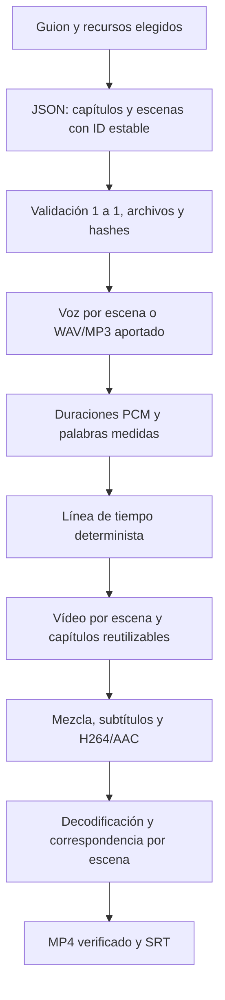

# AutoStudio Director 2 — párrafos y escenas verificables

[Descargar APK verificada](https://github.com/Luixifer/AutoStudio/releases/download/director-check-44922919559/AutoStudio-Director-2.0.0-lab.apk) · [Pruebas, vídeos y limitaciones](VALIDATION.md).

Edición de laboratorio en `codex/director-2-scene-integrity`. [Auditoría](AUDIT.md). Conserva las versiones anteriores y sus datos.

## Desde el Samsung

1. Crear documental y escribir su título.
2. Pegar el guion dejando **una línea en blanco entre párrafos**, o importar TXT, Markdown básico o JSON.
3. Seleccionar las imágenes/MP4 en orden, o abrir cada tarjeta y adjuntar su recurso. Cada tarjeta muestra el párrafo completo, su recurso y la duración medida cuando hay un resultado compatible.
4. Revisar la correspondencia. Si faltan recursos, se bloquea la generación. Para corregir el orden se mueve la escena completa.
5. Elegir narrador, música propia/licenciada y subtítulos. Cada escena permite encuadre, movimiento, pausa posterior, transición y locución WAV/MP3 propia.
6. Generar, mantener abierta durante la subida, consultar resultado, reproducir y guardar en Descargas.

La voz se genera por escena y se mide realmente. No se acelera para ajustarla a una imagen. Los fragmentos internos de inferencia comparten el mismo recurso y el mismo ID de escena. Si un clip resulta más corto que su locución, el motor lo rechaza; repetirlo requiere marcar explícitamente su bucle en el editor.

La previsualización de una tarjeta muestra el recurso de entrada; el clip se reproduce sin su audio original. No se presenta como una previsualización local de voz sintetizada. La síntesis y el montaje final siguen ejecutándose en GitHub.

### Guion JSON

```json
{
  "chapters": [{
    "id": "capitulo-1",
    "title": "Las luces de Hessdalen",
    "scenes": [
      {"id": "hessdalen-001", "text": "Primer párrafo completo."},
      {"id": "hessdalen-002", "text": "Segundo párrafo completo."}
    ]
  }]
}
```

También se acepta `narration` en lugar de `text`, y una lista raíz `scenes`. Los IDs se conservan y se validan. Las imágenes se adjuntan por el selector Android; importar un JSON de guion no importa automáticamente archivos de sus rutas. El Markdown admite encabezados de capítulo y párrafos; no es un renderizador completo de tablas o medios embebidos.

## Fuente de verdad y línea de tiempo



Campos de entrada: `id`, `narration`, `media`, `pause_after`, `camera`, `transition`, `voice`. Campos medidos en `timeline.json`: posición, capítulo, texto original, hash del recurso, archivo de voz, duración de locución, silencio inicial, pausa posterior, inicio/fin global, duración visual, cues y estado de validación.

Transición estricta: voz A → pausa A → disolución en silencio → un fotograma de margen → voz B. La duración es función de muestras de audio y fotogramas reales, no del tamaño del texto.

## Motor y recuperación

```sh
python -m pip install -r requirements-director.txt
python scripts/fetch_voice.py
python -m scripts.director.engine proyecto/project.json --out resultado
python -m scripts.director.engine proyecto/project.json --chapter capitulo-1 --out resultado
python -m scripts.director.verify_render proyecto/project.json --out resultado
```

Las escenas completas y capítulos se reutilizan por huellas de datos, código, recursos y archivos. Se comprueba su integridad antes de reutilizar. La reutilización automática opera en el mismo directorio de trabajo. Para trasladar capítulos entre runners se conservan las herramientas `scripts.director.chapters split/package/assemble`. El formato portátil sigue rechazando efectos puntuales por escena; el motor completo sí los admite.

## Límites actuales

- Objetivo 5–60 minutos; el extremo de una hora **no está validado**. Hasta 10 minutos por capítulo, 60 por proyecto, 200 MiB por entrada, menos de 2 GiB por adjunto y presupuesto de trabajo acotado.
- La APK no reparte automáticamente un proyecto largo entre múltiples runners ni restaura una caché entre ejecuciones independientes. El empaquetado/ensamblaje portátil funciona como herramienta, no como cola Android terminada.
- Voz Álex/Santa CPU gratuita; naturalidad, acento e interpretación documental pendientes de escucha humana. No hay clonación encargada ni API facturable.
- Música aportada o cama ambiental original provisional en la demostración. No se descarga música comercial. Se mantienen atenuación durante voz, fundidos, normalización y limitador.
- Encuadres: completo, recorte centrado o fondo ampliado/desenfocado. No se afirma detección semántica de sujetos. Parallax solo con capas compatibles realmente transparentes.
- Tres estilos de subtítulos y opción de no incrustarlos; SRT disponible como archivo del resultado en GitHub. No hay todavía botón independiente para exportar SRT desde el reproductor Android.
- Guardado de borradores y recuperación de solicitud; transferencias reanudables y reconciliación automática de un POST con respuesta perdida siguen pendientes.
- La APK LAB tiene identidad separada: no desinstalar las anteriores. La conexión se configura una vez en esta instalación. Aún no se distribuye con firma comercial estable.
- No hay prueba física de esta revisión en Samsung. El selector SAF y la comodidad de edición requieren prueba manual.

**Hessdalen sigue pendiente:** no se ha recibido el guion ni los recursos definitivos dentro de la APK. Las demostraciones son material técnico original identificado y no sustituyen ese capítulo. No se declara el producto terminado ni una calidad cinematográfica aprobada.
